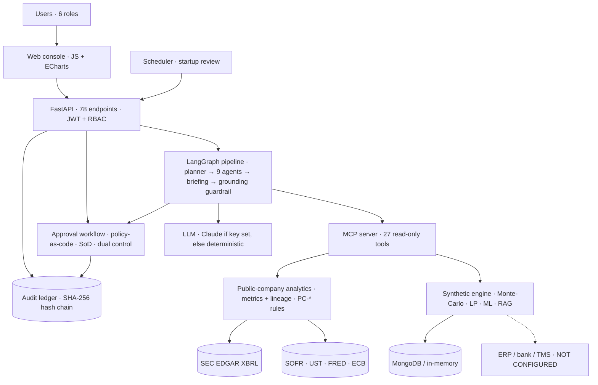

<div align="center">

# MERIDIAN

### Enterprise AI Liquidity, Treasury & Working-Capital Intelligence Platform

DATA → INTELLIGENCE → FORECAST → OPTIMIZATION → RECOMMENDATION → HUMAN REVIEW → APPROVAL → PREPARATION → DUAL-CONTROL EXECUTION

**Primary case: Caterpillar Inc. (NYSE: CAT): `PUBLIC · REAL` data from SEC EDGAR XBRL filings and public market data.**

**FastAPI · LangGraph · MCP · Claude (Anthropic, configurable) · MongoDB · scikit-learn · SciPy HiGHS · ECharts**


</div>

## Architecture



## Analyse any SEC-reporting company

Caterpillar is the primary case, but Meridian is not limited to one company. Open the company menu in the header
(**switch / add company**), type any ticker or 10-digit CIK (for example `MMM`, `MSFT` or `0000021344`) and press **Add**.
Meridian fetches the issuer's XBRL company facts live from SEC EDGAR, validates them, stores a dated, checksummed
snapshot, and the same governed pipeline (agents, metrics with lineage, recommendations, approvals, audit) runs on it.

* Bundled snapshots (work offline): Caterpillar (CAT), The Coca-Cola Company (KO), Honeywell (HON), Apple (AAPL), Deere (DE).
* API: `GET /v1/companies`, `POST /v1/companies {"query": "MSFT"}` (requires `run_agents`; audited `company_added`).
  Every `/v1/public/*` endpoint, governed run and recommendation list takes `cik`.
* Nothing is estimated to fill gaps: a filer without us-gaap 10-K/10-Q cash or revenue facts (for example an IFRS
  20-F filer) is refused with the reason; a concept the issuer does not tag is shown as NOT AVAILABLE; debt facts
  older than the latest 10-K are treated as stale, not reused.
* Peer context uses a default industrial peer set unless peers are given; the UI states that comparisons are directional.

## Three data classes, never mixed

| Label | What it is | Where it is used |
|---|---|---|
| `PUBLIC · REAL` | Caterpillar Inc.'s as-filed SEC XBRL facts from its 10-K and 10-Q filings (cash, receivables, inventories, payables, revenue, COGS, operating profit, D&A, operating cash flow, capex, dividends, repurchases, short-term borrowings, long-term debt and its maturity schedule, committed facilities, cash interest paid, derivative notional, RPO), SEC peer 10-K facts, NY Fed SOFR/EFFR, the U.S. Treasury par curve, FRED ICE BofA Single-A and BBB OAS, and ECB FX | All 14 workspaces of the primary case |
| `SYNTHETIC · EVALUATION` | A simulated multinational ("Orion Industrial Group") | Only for capabilities that need private transaction data: the 13-week invoice-level forecast, intercompany optimisation, collections and supplier analytics, and payment-file (pain.001) execution controls. Switch to it in the header; it is labelled on every screen |
| `CLIENT · NOT CONFIGURED` | ERP (SAP S/4HANA, Oracle Fusion, NetSuite), bank host-to-host / SWIFT, TMS, SSO | Interfaces exist and are tested (ERP CSV, ISO 20022 camt.053, BAI2, debt/covenant CSV). No live connector is claimed |

Every `PUBLIC · REAL` number opens a lineage drawer:
**SOURCE → FILING (form, accession, filed date, EDGAR link) → PERIOD → FACTS → TRANSFORMATION → CALCULATION → RESULT → USED BY**.
If public data cannot support a metric, it is shown as `NOT AVAILABLE FROM PUBLIC DATA` with the reason. Nothing is imputed.

## What the platform concludes for Caterpillar (latest data: 10-Q to 2026-06-30, 10-K FY2025)

| | Value | Basis |
|---|---|---|
| Cash & equivalents (2026-06-30) | $6.71B | REPORTED |
| Liquidity: cash + undrawn committed facilities (2025-12-31) | $19.64B | CALCULATED |
| Debt due within 12 months | $12.63B (1.55x covered) | CALCULATED |
| Total debt / net debt (2025-12-31, incl. Cat Financial) | $43.33B / $33.35B | CALCULATED |
| FCF proxy vs shareholder returns (TTM) | $10.70B vs $10.04B | CALCULATED |
| DSO / DIO / DPO / CCC | 64.4 / 153.4 / 76.7 / 141.1 days | CALCULATED |
| +100 bps on debt due ≤12m | $126.3M a year | ESTIMATED |

At start-up a scheduled, audited governed run evaluates five reference-policy rules (PC-*), so the dashboard opens with live decisions. It produces **three recommendations**, because the evidence triggers three rules:

1. Refinancing-readiness plan (CFO).
2. Receivables review, because DSO rose 8.3 days year on year (Treasurer / WC Manager).
3. Rate-risk review (Treasurer).

It also reports the two rules that were **not** triggered: liquidity coverage and shareholder returns vs FCF. Recommendations are decision mandates, so no money ever moves. The PC-* policy is Meridian's illustrative reference framework, **not** Caterpillar's internal policy.

## Fifteen workspaces


**Value at Stake.** Cross-company working-capital study on 390 companies' SEC filings, company lookup with filing links, forecast validation on real invoices, board report.

| | |
|---|---|
|  **Liquidity Intelligence.** Debt composition, coverage, cost of debt, repricing and refinancing estimates, market rates |  **Financial Network.** Company → domains → metrics → filings, plus peers, market data, recommendations and policy |
|  **Working Capital.** DSO/DIO/DPO/CCC trend, YoY bridge, balances, SEC peer context with caveats |  **Forecast Studio.** Seasonal cash outlook with P10–P90 band; point-in-time forecast-vs-actual back-test |
|  **Scenario Lab.** Revenue, DSO, DIO, rate and spread shocks → FCF, coverage, leverage |  **AI Decision Center.** Grounded Q&A and the full governed agent run (findings, trace, reproducibility) |
|  **Recommendations.** Impact with basis, constraints, risks, evidence, lineage DAG to SEC facts, verified policy citations |  **Approval Center.** Authority, SoD, scopes, workflow stepper, preparation checks, dual-control issue |
|  **Data Lineage.** Source register, metric register, data boundary, connector status |  **Audit & Governance.** Hash-chain verification, denials, agent registry, model card |

Policy & Evidence, System Operations and Administration are in `docs/images/v3/`. Adding a company: [`15_company_menu.png`](docs/images/v3/15_company_menu.png), [`16_added_company_MSFT.png`](docs/images/v3/16_added_company_MSFT.png). The full 24-step approval journey is in [`docs/images/v3/journey/`](docs/images/v3/journey).

## AI provider

`MERIDIAN_LLM_PROVIDER=auto` (default) uses Claude via the Anthropic API when `ANTHROPIC_API_KEY` is set. Without a key, Meridian runs deterministic reasoners over the same tool evidence and the header says **AI OFFLINE / DETERMINISTIC**. It never claims Claude is active when it is not. Model: `MERIDIAN_LLM_MODEL` (default `claude-sonnet-4-5`). Vertex AI and Bedrock are also supported. Verify a live round-trip with `meridian llm-check`. With Claude or without it, every dollar figure an agent writes must match tool output (numeric grounding), and every cited policy clause must have been retrieved (citation verification).

## Quickstart: native Windows (PowerShell), no Docker, no WSL

```powershell
py -3.12 -m venv .venv
.\.venv\Scripts\Activate.ps1
pip install -e ".[dev]"
$env:MERIDIAN_MODE="demo"            # evaluation deployment: evaluation sign-ins, synthetic + real public data
# data is stored persistently in var\meridian.db (SQLite, built into Python, free) and survives restarts
# optional: $env:ANTHROPIC_API_KEY="..."   → enables Claude; otherwise AI OFFLINE / DETERMINISTIC
uvicorn meridian.api.main:app --port 8000
```

Open http://localhost:8000/. Evaluation sign-ins (password on the sign-in screen; refused outside evaluation mode): `ana` Finance Analyst · `wendy` Working Capital Manager · `tom` Group Treasurer · `carla` CFO · `iris` Internal Audit · `ada` Finance Administrator.

```powershell
pytest -q                                          # 300 passed, 11 skipped (MongoDB + live-network suites run separately)
meridian db status                                 # persistent store: schema version, record counts, audit chain
meridian db backup                                 # verified online backup to backups\meridian-<timestamp>.db
$env:MERIDIAN_NETWORK_TESTS="1"; pytest tests/network   # live SEC, NY Fed, Treasury, FRED, ECB
meridian audit verify                              # verify the hash-chained audit ledger
python -m meridian.evaluation.benchmark --seed 7   # evaluation gates (also 11, 23)
python scripts/refresh_public_company.py           # refresh the Caterpillar + peers snapshot from SEC EDGAR (other companies: add/refresh from the header menu)
meridian doctor                                    # production readiness
```

The UTF-8 handling is Windows-safe: every file read and write declares `encoding="utf-8"`, and console assets are served with `charset=utf-8`. Both are enforced by tests.

## Production

See [`docs/production-runbook.md`](docs/production-runbook.md). Production mode refuses to start with in-memory storage, without a signing key, or without client data loaded through governed ingestion. SQLite (single node) and deterministic AI are accepted but reported as warnings. **Meridian is not yet deployed against a real client system** — see the blocker list in [`PRODUCTION_READINESS_REPORT.md`](PRODUCTION_READINESS_REPORT.md).

## What 3.5 adds — Value at Stake (real data, ₹0)

* **Cross-company working-capital study on real SEC filings:** 390 large US-listed companies, fiscal year 2025.
  **$152.1B** of cash is tied up in receivables and inventory beyond peer medians ($355.1B to top quartile); supplier
  terms ($53.1B) are reported separately, and 12 companies whose peer comparison is unfair (e.g. Amazon, Microsoft) are
  routed to segment review instead of inflating the headline. Every input links to its SEC accession number.
  See [`docs/VALUE_AT_STAKE_STUDY.md`](docs/VALUE_AT_STAKE_STUDY.md).
* **Forecast validation on real transactions:** 1,067,371 real invoice lines (UCI Online Retail II, D. Chen, CC BY 4.0), 30 rolling origins,
  13-week horizon, no leakage — results reported as they are, including where the method does not beat a baseline.
* **Board report:** one click from the Value at Stake workspace; every figure computed at render time.
* **Demo and interview guide:** [`docs/DEMO_AND_INTERVIEW_GUIDE.md`](docs/DEMO_AND_INTERVIEW_GUIDE.md).

## What 3.4 adds (integrity and control hardening, ₹0)

* **No silently mixed dates:** liquidity and its coverage now use cash, facilities and debt from one balance-sheet
  date (this corrected Coca-Cola's coverage from 3.75x to 5.27x). Any metric that combines dates by definition says so.
* **Stale-data warnings:** a snapshot more than 135 days behind its latest filed quarter is flagged on every page and
  in Data Lineage.
* **Approval integrity:** decisions on superseded runs or under a changed policy version are refused; replays are
  refused; two simultaneous decisions cannot both succeed (compare-and-swap on the run revision in SQLite, MongoDB and
  memory); the decision audit record carries the policy version and evidence.
* **Four-eyes on privileged roles:** granting Treasurer, CFO or Administrator through the API needs a second
  administrator; nobody can change their own role; lockout no longer reveals whether an account exists.
* **New tests:** formula reconciliation for every bundled company, TTM vs annual + YTD, units, staleness, invalid
  inputs, escalation, replay, concurrency, SEC outage.

## What 3.3 adds (₹0, no install)

* **Persistent by default:** users, runs, approvals, decisions, added companies and the audit chain are stored in
  SQLite (`var/meridian.db`, part of Python — no server, no Docker, no cost) and survive restarts (tested across three
  separate processes). Versioned migrations, verified online backup and restore (`meridian db ...`). The audit table is
  append-only inside the database (triggers reject UPDATE/DELETE). MongoDB remains supported for multi-replica setups.
* **No silent memory fallback:** in-memory storage is for automated tests only and is refused in production mode.
* **Access control proven on every route:** all 70+ `/v1` endpoints refuse anonymous calls; each role's permissions
  are tested on direct API calls.
* **Bank statement quality:** opening + entries = closing reconciliation to the cent, duplicate statement and
  transaction detection.
* **AI at ₹0:** deterministic, evidence-grounded reasoning needs no API key and makes no external AI calls; Claude is
  optional and off unless you set a key.

## What 3.2 adds (production hardening)

* **Precision-aware grounding:** every $ figure and multiple an AI writes must equal a tool-computed value at the
  precision shown (`$12.63B` ±$5M), with sign and currency checks, instead of a blanket 2% tolerance.
* **Claude client:** outbound DLP redaction, timeouts and bounded retries, token budget per run, and honest labels:
  live Claude, offline deterministic, or a labelled fallback after an error or exhausted budget.
* **Resilient public-data layer:** retries with backoff, `Retry-After`, SEC fair-access throttling, caching; opt-in
  live tests against the real sources.
* **Audit you can defend:** sequence-bound hashes, tamper tests, external chain anchors, and a MongoDB role that can
  append to the audit log but never change or delete it.
* **Operations:** JSON access logs with request ids, release secret scanner, dependency audit, runbook for backup,
  rollback and incidents. See [`PRODUCTION_READINESS_REPORT.md`](PRODUCTION_READINESS_REPORT.md) for what is verified
  and what still needs client systems or credentials.

## Documentation

* [`PRODUCTION_READINESS_REPORT.md`](PRODUCTION_READINESS_REPORT.md) — 3.5 production blockers, verification and readiness by category
* [`docs/VALUE_AT_STAKE_STUDY.md`](docs/VALUE_AT_STAKE_STUDY.md) — cross-company working-capital study (method, findings, limits)
* [`docs/DEMO_AND_INTERVIEW_GUIDE.md`](docs/DEMO_AND_INTERVIEW_GUIDE.md) — 3-minute demo and interview Q&A
* [`docs/ROADMAP_TO_LIVE_DEPLOYMENT.md`](docs/ROADMAP_TO_LIVE_DEPLOYMENT.md) — phases to a live deployment: built today vs needs a client
* [`docs/PRODUCTION_READINESS_REPORT_v3.4.md`](docs/PRODUCTION_READINESS_REPORT_v3.4.md), [`v3.3`](docs/PRODUCTION_READINESS_REPORT_v3.3.md) — earlier hardening rounds
* [`docs/FINAL_VERIFICATION_REPORT.md`](docs/FINAL_VERIFICATION_REPORT.md) — 3.1 verification (history)
* [`docs/PUBLIC_COMPANY_CASE.md`](docs/PUBLIC_COMPANY_CASE.md) — real-company data inventory, metric definitions, lineage, limits
* [`docs/PLATFORM_V3.md`](docs/PLATFORM_V3.md) — architecture, agents, graph, RAG/policy, security, SoD, audit
* [`docs/governance.md`](docs/governance.md), [`docs/AUDIT.md`](docs/AUDIT.md), [`docs/adr/`](docs/adr), [`docs/evidence/`](docs/evidence)

---

**Disclaimer.** Company figures (Caterpillar and the 390 companies in the Value at Stake study) are as filed with the SEC and are used for analysis only. Meridian is not affiliated with any company analysed; value-at-stake estimates are hypotheses from public filings, not findings about any company. Recommendations are illustrative outputs of a reference policy, not advice to the company. The evaluation company, its policies and agreements are fictional. This is not financial or legal advice.

**Author:** Shraddha Todkari.
