<div align="center">

# MERIDIAN

### Enterprise AI Liquidity, Treasury & Working-Capital Intelligence Platform

DATA → INTELLIGENCE → FORECAST → OPTIMIZATION → RECOMMENDATION → HUMAN REVIEW → APPROVAL → PREPARATION → DUAL-CONTROL EXECUTION

**Primary case: Caterpillar Inc. (NYSE: CAT): `PUBLIC · REAL` data from SEC EDGAR XBRL filings and public market data.**

**FastAPI · LangGraph · MCP · Claude (Anthropic, configurable) · MongoDB · scikit-learn · SciPy HiGHS · ECharts**


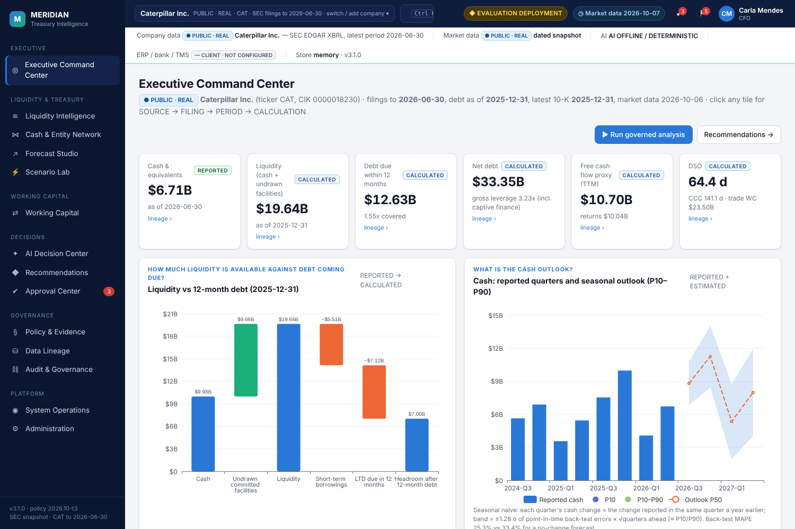

</div>

## Architecture

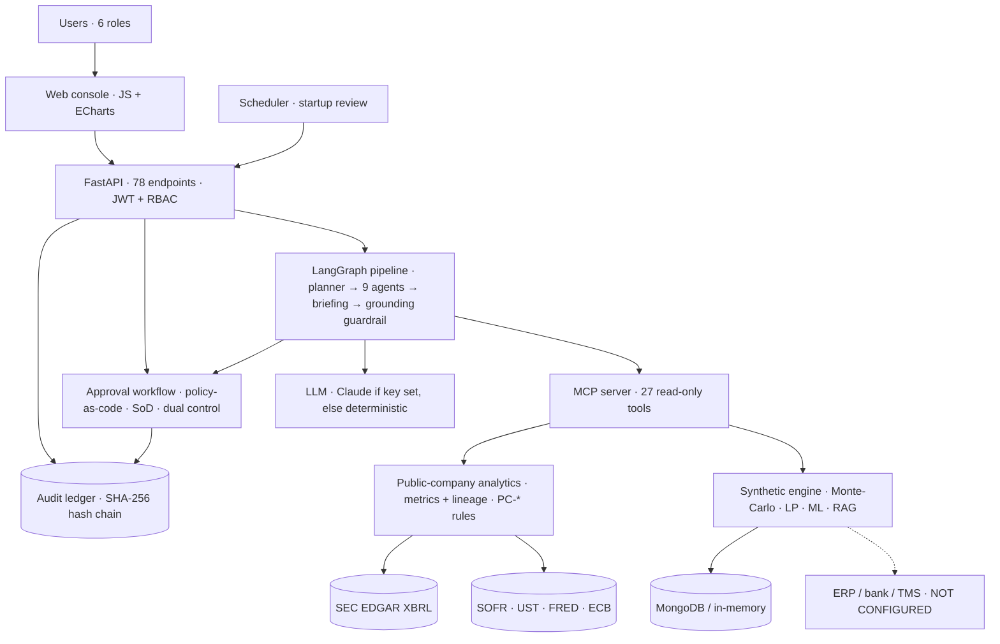

## Analyse any SEC-reporting company

Caterpillar is the primary case, but Meridian is not limited to one company. Open the company menu in the header
(**switch / add company**), type any ticker or 10-digit CIK (for example `MMM`, `MSFT` or `0000021344`) and press **Add**.
Meridian fetches the issuer's XBRL company facts live from SEC EDGAR, validates them, stores a dated, checksummed
snapshot, and the same governed pipeline (agents, metrics with lineage, recommendations, approvals, audit) runs on it.

* Bundled snapshots (work offline): Caterpillar (CAT), The Coca-Cola Company (KO), Honeywell (HON), Apple (AAPL), Deere (DE).
* API: `GET /v1/companies`, `POST /v1/companies {"query": "MSFT"}` (requires `run_agents`; audited `company_added`).
  Every `/v1/public/*` endpoint, governed run and recommendation list takes `cik`.
* Nothing is estimated to fill gaps: a filer without us-gaap 10-K/10-Q cash or revenue facts (for example an IFRS
  20-F filer) is refused with the reason; a concept the issuer does not tag is shown as NOT AVAILABLE; debt facts
  older than the latest 10-K are treated as stale, not reused.
* Peer context uses a default industrial peer set unless peers are given; the UI states that comparisons are directional.

## Three data classes, never mixed

| Label | What it is | Where it is used |
|---|---|---|
| `PUBLIC · REAL` | Caterpillar Inc.'s as-filed SEC XBRL facts from its 10-K and 10-Q filings (cash, receivables, inventories, payables, revenue, COGS, operating profit, D&A, operating cash flow, capex, dividends, repurchases, short-term borrowings, long-term debt and its maturity schedule, committed facilities, cash interest paid, derivative notional, RPO), SEC peer 10-K facts, NY Fed SOFR/EFFR, the U.S. Treasury par curve, FRED ICE BofA Single-A and BBB OAS, and ECB FX | All 14 workspaces of the primary case |
| `SYNTHETIC · EVALUATION` | A simulated multinational ("Orion Industrial Group") | Only for capabilities that need private transaction data: the 13-week invoice-level forecast, intercompany optimisation, collections and supplier analytics, and payment-file (pain.001) execution controls. Switch to it in the header; it is labelled on every screen |
| `CLIENT · NOT CONFIGURED` | ERP (SAP S/4HANA, Oracle Fusion, NetSuite), bank host-to-host / SWIFT, TMS, SSO | Interfaces exist and are tested (ERP CSV, ISO 20022 camt.053, BAI2, debt/covenant CSV). No live connector is claimed |

Every `PUBLIC · REAL` number opens a lineage drawer:
**SOURCE → FILING (form, accession, filed date, EDGAR link) → PERIOD → FACTS → TRANSFORMATION → CALCULATION → RESULT → USED BY**.
If public data cannot support a metric, it is shown as `NOT AVAILABLE FROM PUBLIC DATA` with the reason. Nothing is imputed.

## What the platform concludes for Caterpillar (latest data: 10-Q to 2026-06-30, 10-K FY2025)

| | Value | Basis |
|---|---|---|
| Cash & equivalents (2026-06-30) | $6.71B | REPORTED |
| Liquidity: cash + undrawn committed facilities (2025-12-31) | $19.64B | CALCULATED |
| Debt due within 12 months | $12.63B (1.55x covered) | CALCULATED |
| Total debt / net debt (2025-12-31, incl. Cat Financial) | $43.33B / $33.35B | CALCULATED |
| FCF proxy vs shareholder returns (TTM) | $10.70B vs $10.04B | CALCULATED |
| DSO / DIO / DPO / CCC | 64.4 / 153.4 / 76.7 / 141.1 days | CALCULATED |
| +100 bps on debt due ≤12m | $126.3M a year | ESTIMATED |

At start-up a scheduled, audited governed run evaluates five reference-policy rules (PC-*), so the dashboard opens with live decisions. It produces **three recommendations**, because the evidence triggers three rules:

1. Refinancing-readiness plan (CFO).
2. Receivables review, because DSO rose 8.3 days year on year (Treasurer / WC Manager).
3. Rate-risk review (Treasurer).

It also reports the two rules that were **not** triggered: liquidity coverage and shareholder returns vs FCF. Recommendations are decision mandates, so no money ever moves. The PC-* policy is Meridian's illustrative reference framework, **not** Caterpillar's internal policy.

## Fourteen workspaces

| | |
|---|---|
| 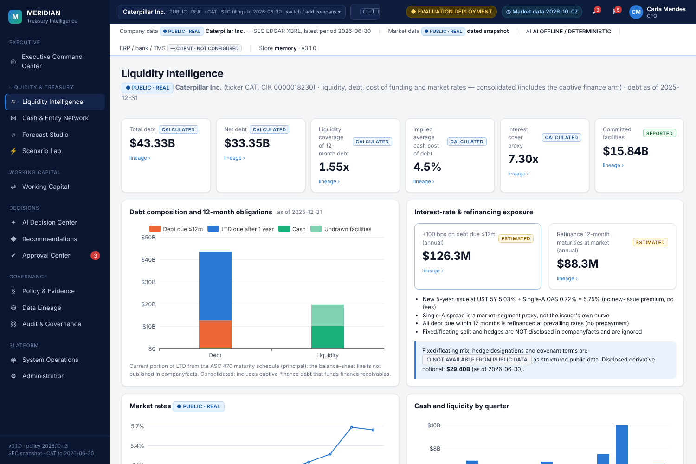 **Liquidity Intelligence.** Debt composition, coverage, cost of debt, repricing and refinancing estimates, market rates | 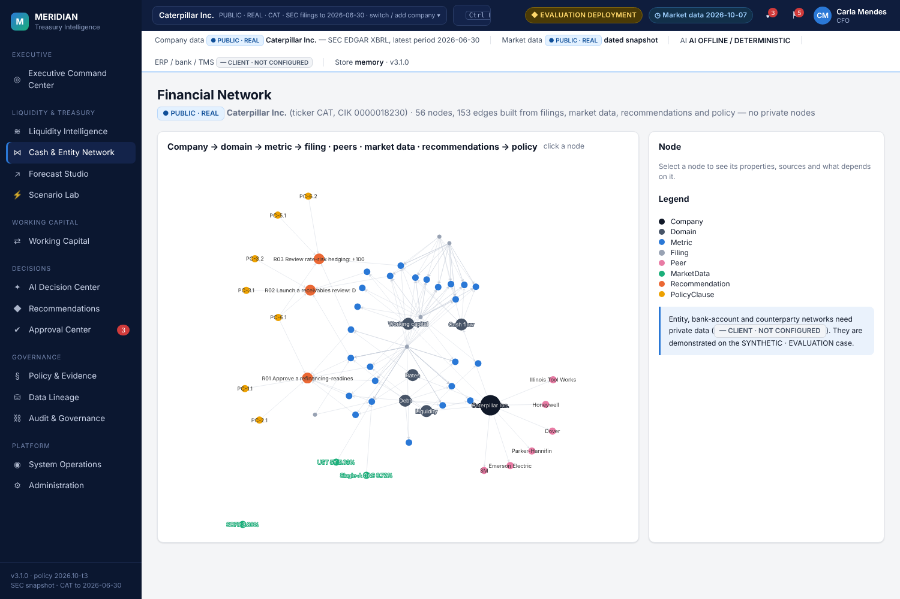 **Financial Network.** Company → domains → metrics → filings, plus peers, market data, recommendations and policy |
| 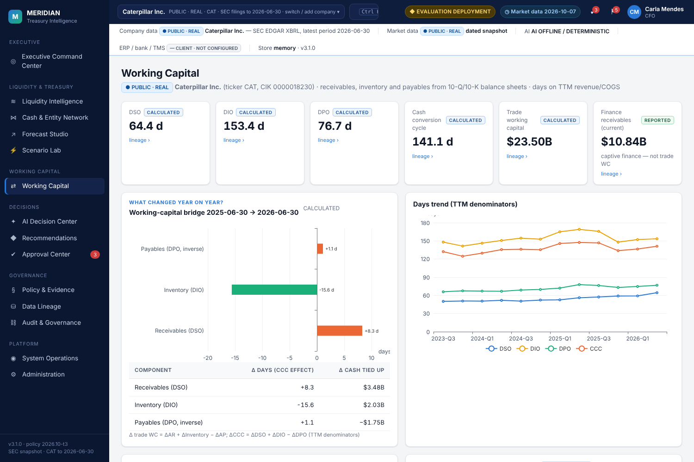 **Working Capital.** DSO/DIO/DPO/CCC trend, YoY bridge, balances, SEC peer context with caveats | 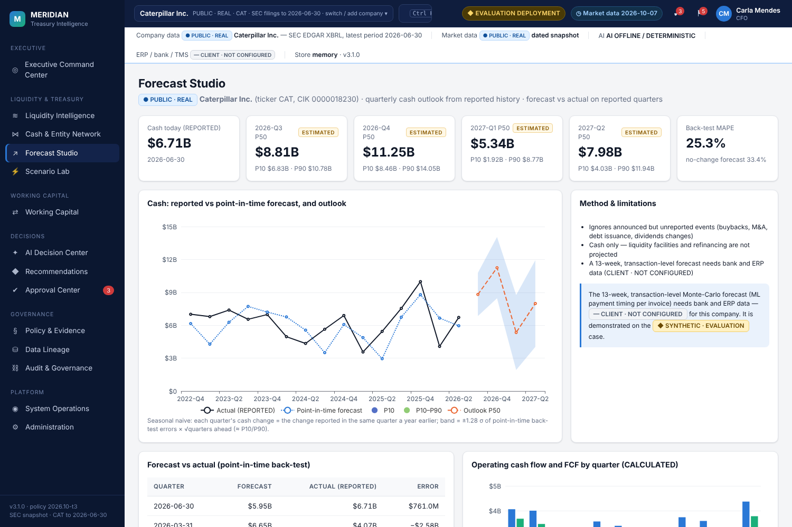 **Forecast Studio.** Seasonal cash outlook with P10–P90 band; point-in-time forecast-vs-actual back-test |
| 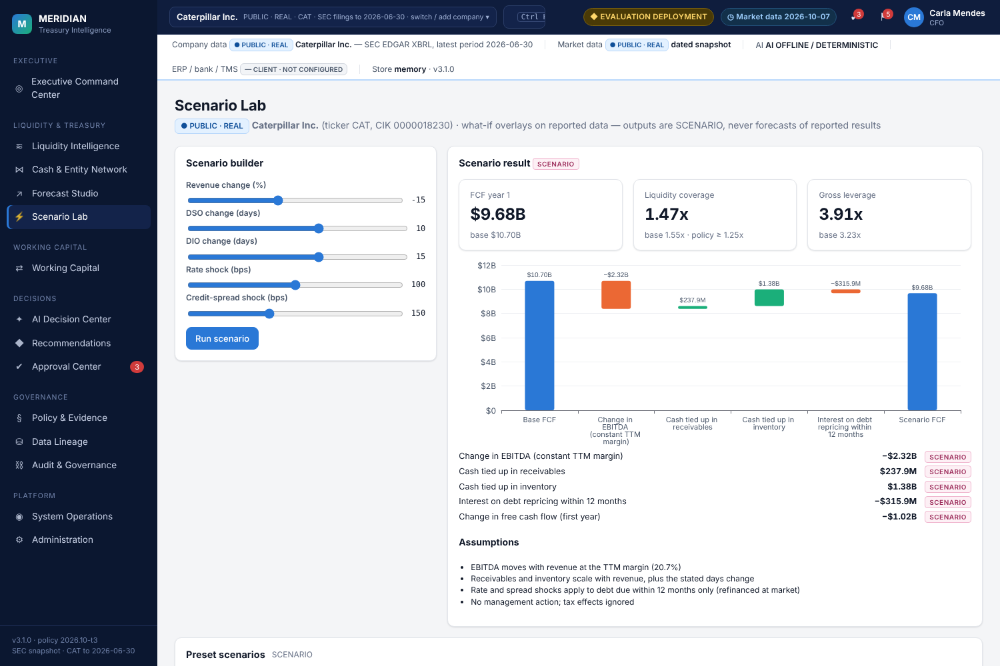 **Scenario Lab.** Revenue, DSO, DIO, rate and spread shocks → FCF, coverage, leverage | 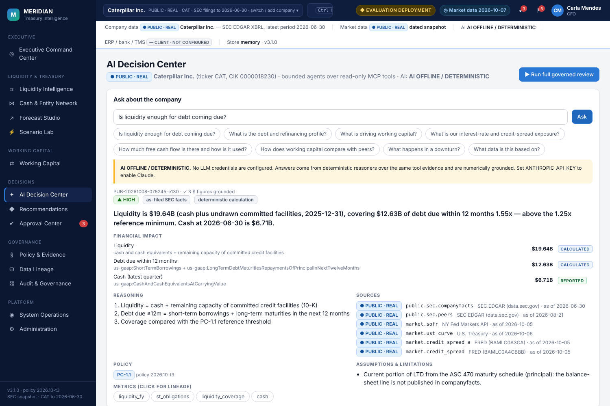 **AI Decision Center.** Grounded Q&A and the full governed agent run (findings, trace, reproducibility) |
| 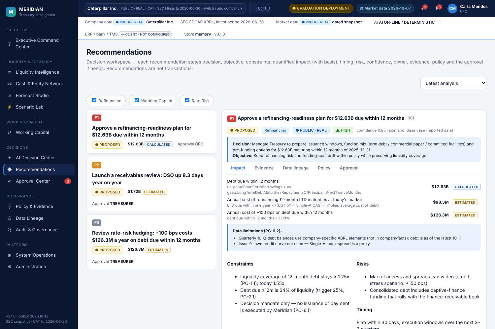 **Recommendations.** Impact with basis, constraints, risks, evidence, lineage DAG to SEC facts, verified policy citations | 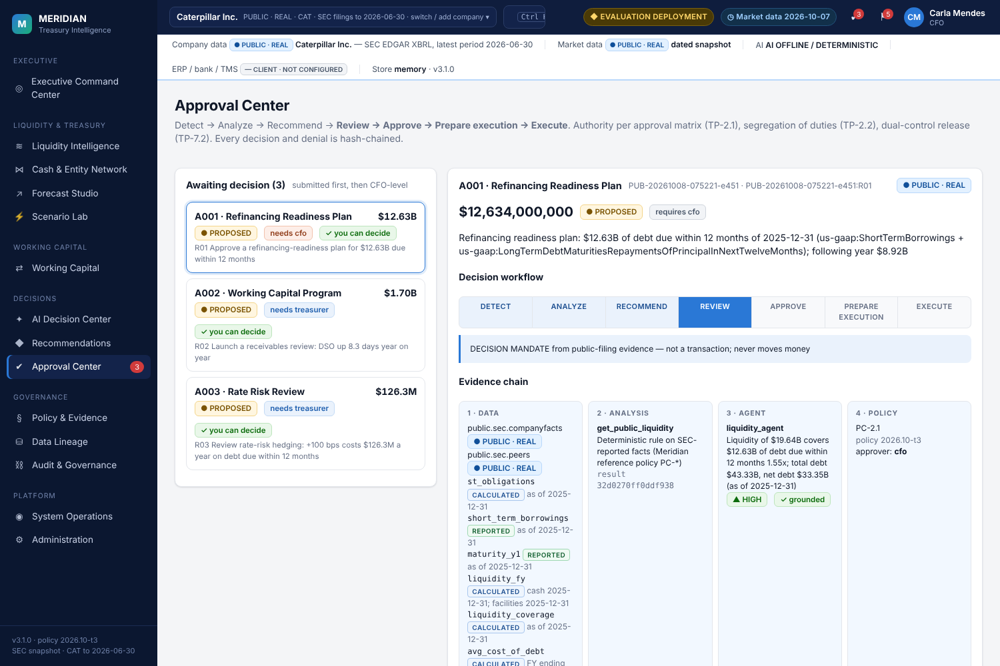 **Approval Center.** Authority, SoD, scopes, workflow stepper, preparation checks, dual-control issue |
| 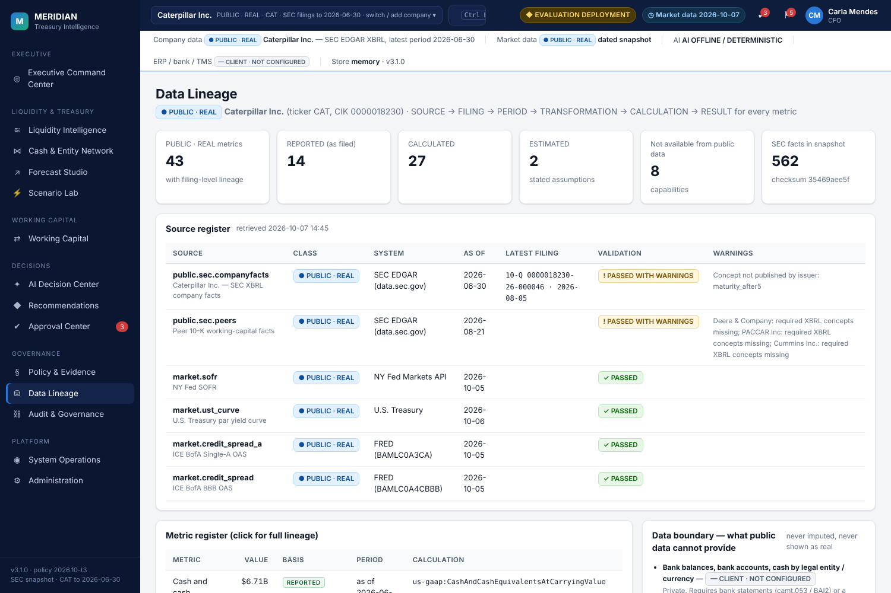 **Data Lineage.** Source register, metric register, data boundary, connector status | 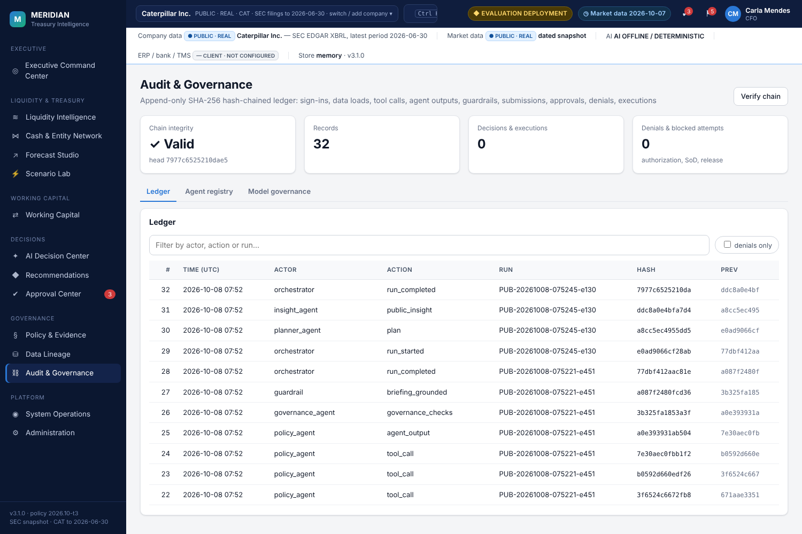 **Audit & Governance.** Hash-chain verification, denials, agent registry, model card |

Policy & Evidence, System Operations and Administration are in `docs/images/v3/`. Adding a company: [`15_company_menu.png`](docs/images/v3/15_company_menu.png), [`16_added_company_MSFT.png`](docs/images/v3/16_added_company_MSFT.png). The full 24-step approval journey is in [`docs/images/v3/journey/`](docs/images/v3/journey).

## AI provider

`MERIDIAN_LLM_PROVIDER=auto` (default) uses Claude via the Anthropic API when `ANTHROPIC_API_KEY` is set. Without a key, Meridian runs deterministic reasoners over the same tool evidence and the header says **AI OFFLINE / DETERMINISTIC**. It never claims Claude is active when it is not. Model: `MERIDIAN_LLM_MODEL` (default `claude-sonnet-4-5`). Vertex AI and Bedrock are also supported. Verify a live round-trip with `meridian llm-check`. With Claude or without it, every dollar figure an agent writes must match tool output (numeric grounding), and every cited policy clause must have been retrieved (citation verification).

## Quickstart: native Windows (PowerShell), no Docker, no WSL

```powershell
py -3.12 -m venv .venv
.\.venv\Scripts\Activate.ps1
pip install -e ".[dev]"
$env:MERIDIAN_MODE="demo"            # evaluation deployment: in-memory store, evaluation sign-ins
# optional: $env:ANTHROPIC_API_KEY="..."   → enables Claude; otherwise AI OFFLINE / DETERMINISTIC
uvicorn meridian.api.main:app --port 8000
```

Open http://localhost:8000/. Evaluation sign-ins (password on the sign-in screen; refused outside evaluation mode): `ana` Finance Analyst · `wendy` Working Capital Manager · `tom` Group Treasurer · `carla` CFO · `iris` Internal Audit · `ada` Finance Administrator.

```powershell
pytest -q                                          # 230 passed, 4 skipped (MongoDB tests need MERIDIAN_TEST_MONGODB_URI)
python -m meridian.evaluation.benchmark --seed 7   # evaluation gates (also 11, 23)
python scripts/refresh_public_company.py           # refresh the Caterpillar + peers snapshot from SEC EDGAR (other companies: add/refresh from the header menu)
meridian doctor                                    # production readiness
```

The UTF-8 handling is Windows-safe: every file read and write declares `encoding="utf-8"`, and console assets are served with `charset=utf-8`. Both are enforced by tests.

## Production

See [`docs/production-runbook.md`](docs/production-runbook.md). Production mode refuses to start without MongoDB, a signing key, a real LLM endpoint, client data loaded through governed ingestion, and validated sources.

## Documentation

* [`docs/FINAL_VERIFICATION_REPORT.md`](docs/FINAL_VERIFICATION_REPORT.md) — what was verified, with results
* [`docs/PUBLIC_COMPANY_CASE.md`](docs/PUBLIC_COMPANY_CASE.md) — real-company data inventory, metric definitions, lineage, limits
* [`docs/PLATFORM_V3.md`](docs/PLATFORM_V3.md) — architecture, agents, graph, RAG/policy, security, SoD, audit
* [`docs/governance.md`](docs/governance.md), [`docs/AUDIT.md`](docs/AUDIT.md), [`docs/adr/`](docs/adr), [`docs/evidence/`](docs/evidence)

---

**Disclaimer.** Caterpillar Inc. figures are as filed with the SEC and are used for analysis only. Meridian is not affiliated with Caterpillar. Recommendations are illustrative outputs of a reference policy, not advice to the company. The evaluation company, its policies and agreements are fictional. This is not financial or legal advice.

**Author:** Shraddha Todkari.
