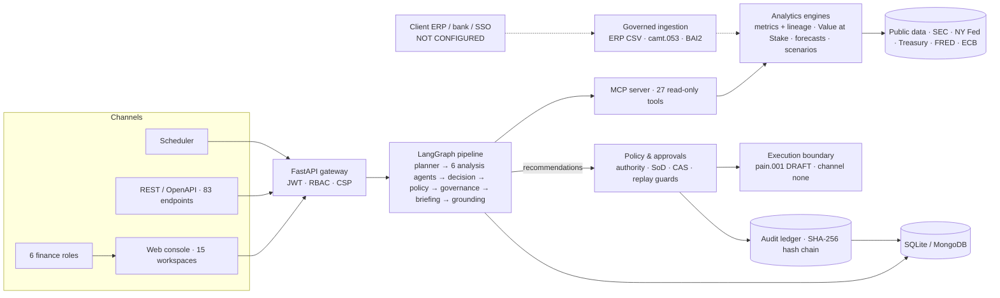
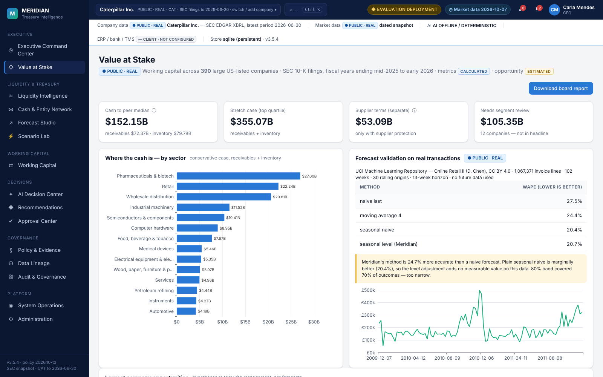

<div align="center">

# Meridian

### Treasury & working-capital intelligence for the CFO office

**Real SEC filings and market data → governed AI agents → policy-checked recommendations → human approval → tamper-evident audit.**
**No money ever moves without people, and Meridian itself can never send a payment.**


</div>

---

## The business problem

**Every company has cash it cannot see and risks it has not priced.** A CFO has to answer three questions every
quarter, and in most companies the answers come from spreadsheets nobody can trace:

| The question | Why it is hard today | What it costs when it goes wrong |
|---|---|---|
| **1. Where is our cash trapped?** Unpaid customer invoices (receivables) and stock sitting in warehouses (inventory) | Data is spread across ERP, banks and spreadsheets; there is no fair comparison with peers | Cash is borrowed that the company already has. For Caterpillar, **one day of collections is worth $205M** ($74.7B revenue ÷ 365) |
| **2. Can we pay the debt that is coming due?** Liquidity vs debt due in the next 12 months | Cash, credit lines and debt are reported on different dates and mixed up | Refinancing is started too late, at worse rates — or a covenant is breached |
| **3. What happens if rates or demand move?** Interest-rate and downturn exposure | Scenarios are built by hand, rarely re-run, and not linked to policy | Surprise costs: +1 % on Caterpillar's 12-month debt is **$126M a year** |

And when a decision is finally made, there is often **no reliable record** of who approved what, on which numbers,
under which policy — exactly what auditors and regulators ask for.

### Who it is for

| Role | What Meridian gives them |
|---|---|
| **CFO** | One screen: liquidity, debt due, cash outlook, risks — and the decisions waiting for them |
| **Group Treasurer** | Refinancing readiness, rate exposure, scenarios, bank-ready payment drafts under dual control |
| **Working-capital manager** | Where receivables and inventory are out of line, with the cash value of fixing it |
| **Analyst** | A full governed analysis in under a second (measured 0.3–0.4 s), with every number traced to its source |
| **Internal audit / risk** | A tamper-evident record of every recommendation, approval, denial and the evidence behind it |
| **Consultants / advisers** | An outside-in working-capital diagnostic across 390 companies — the first step of a cash-release engagement |

### How Meridian solves it

| Step | What happens | Outcome |
|---|---|---|
| 1. Collect | Pulls real filings (SEC) and market rates; later a client's ERP and bank files | Numbers with a source, a date and a filing link |
| 2. Analyse | Calculates liquidity, debt, free cash flow, working-capital days, peer benchmarks, scenarios | Consistent, same-date metrics — no spreadsheet errors |
| 3. Recommend | AI agents check the numbers against policy rules and draft recommendations with their evidence | e.g. "Approve a refinancing plan for $12.63B due within 12 months" |
| 4. Decide | The right person approves or rejects; the requester can never approve their own request | Decisions follow the company's approval matrix |
| 5. Record | Every decision and every denied attempt goes into a hash-chained audit trail | Audit-ready; any tampering is detected |
| 6. Execute safely | Approved payments become draft bank files; release needs a second person; Meridian itself cannot send money | No unauthorised or accidental payments |

### Real-life use cases

* **Quarterly liquidity review** — the CFO sees whether liquidity covers the next 12 months of debt and approves a
  refinancing plan in time (Caterpillar: 1.55x covered, plan triggered because debt due is 64 % of liquidity).
* **Working-capital programme** — find which lever (collections, inventory, supplier terms) releases the most cash and
  size it against peers (Caterpillar: inventory 148 days vs 98 for peers → **$6.1B**).
* **Rate and downturn planning** — test "revenue −15 %, collections +10 days, rates +1 %" and see free cash flow,
  coverage and leverage move together.
* **Board pack** — one-click report with the headline numbers, sources and limitations.
* **Audit and controls** — show auditors exactly who approved what, when, on which evidence and policy version.
* **Outside-in diagnostic** — benchmark any SEC-listed company before an engagement or an investment discussion.

**Meridian** turns public filings and market data into decision-ready recommendations, and puts every one of them
through the controls a CFO office needs: approval authority, segregation of duties, dual control and a
tamper-evident audit trail.

## What it found (real data)

| | Result | Basis |
|---|---|---|
| **Cash trapped in working capital** — 390 large US-listed companies, FY2025 SEC filings | **$152.1B** beyond peer medians (receivables $72.4B, inventory $79.8B); **$355.1B** to peer top quartile | ESTIMATED from REPORTED filings |
| Supplier-terms opportunity (shown separately — it comes out of suppliers' pockets) | $53.1B, only with supplier-finance or card-programme protection | ESTIMATED |
| Caterpillar — liquidity vs debt due within 12 months | $19.64B vs $12.63B → **1.55x** covered; refinancing-readiness plan triggered (64 % of liquidity) | CALCULATED |
| Caterpillar — inventory vs industrial-machinery peers | 148 days vs 98 median → **$6.1B** opportunity | ESTIMATED |
| Forecast method on **1,067,371 real invoices** (13-week, rolling origin, no leakage) | 24.7 % better than naive; *not* better than seasonal-naive — reported as is | Measured |

Every input links to its SEC filing (accession number). Opportunities are hypotheses for management, not findings
about any company. Full method: [`docs/VALUE_AT_STAKE_STUDY.md`](docs/VALUE_AT_STAKE_STUDY.md).

## Architecture


<details>
<summary>Text version (Mermaid)</summary>



</details>

| Layer | What it does | Key modules |
|---|---|---|
| Channels | Role-aware console (15 workspaces), REST API, scheduled governed review | `console/`, `api/main.py` |
| API & security | JWT sessions, RBAC on every route, four-eyes role grants, lockout without enumeration, security headers | `api/`, `security/auth.py` |
| Intelligence | LangGraph agent pipeline over a read-only MCP tool server; Claude when a key is set, deterministic reasoners otherwise; every $ figure grounded against tool output | `orchestration/`, `mcp_server/`, `agents/`, `llm/` |
| Analytics | Public-company metrics with filing-level lineage, recast-safe TTM, cross-company Value at Stake, forecasts, scenarios, Monte-Carlo / LP / ML on the synthetic case | `public_company/`, `benchmark/`, `analytics/`, `ml/` |
| Governance | Policy-as-code approval matrix, segregation of duties, superseded-run / policy-drift / replay guards, compare-and-swap, dual-control release, hash-chained audit | `governance/`, `orchestration/service.py`, `execution/` |
| Data | Dated, checksummed public snapshots; governed ingestion (ERP CSV, ISO 20022 camt.053, BAI2); SQLite by default, MongoDB for multi-replica | `market/`, `ingest/`, `store/` |

## Trust by design

* **Three data classes, never mixed.** `PUBLIC · REAL` (SEC filings, market data), `SYNTHETIC · EVALUATION` (a
  fictional group used only where private ledgers are needed) and `CLIENT · NOT CONFIGURED` (ERP, bank, SSO
  interfaces). Every screen says which one you are looking at.
* **Lineage on every number:** SOURCE → FILING (form, accession, date) → PERIOD → FACTS → TRANSFORMATION →
  CALCULATION → RESULT. If public data cannot support a metric it shows *Not available*, never a guess.
* **Financial integrity:** balances and flows share one date (mixed dates must declare why); TTM bridges the latest
  fiscal year and year-to-date figures so restatements are handled; stale snapshots are flagged.
  54/54 reported figures of the bundled companies equal live SEC values
  ([evidence](docs/evidence/sec_reconciliation_all_companies.txt)).
* **AI you can audit:** agents only call read-only tools; every dollar figure and multiple they write must match a
  computed value at the precision shown; cited policy clauses must have been retrieved; outbound text is DLP-redacted.
* **Decisions, not transactions.** Recommendations are decision mandates. Approval needs the right authority and a
  different person from the requester; payment files stop at a validated DRAFT and the transmission channel is `none`.

## Fifteen workspaces

| | |
|---|---|
|  **Value at Stake** — 390-company working-capital study, company lookup with filing links, forecast validation, board report |  **Liquidity Intelligence** — debt composition, coverage, cost of debt, refinancing and repricing estimates, market rates |
|  **Working Capital** — DSO/DIO/DPO/CCC trend, year-on-year bridge, peers, value at stake |  **Scenario Lab** — revenue, collection, inventory, rate and spread shocks → FCF, coverage, leverage |
|  **AI Decision Center** — governed agent run, grounded Q&A, trace, reproducibility |  **Approval Center** — authority, segregation of duties, evidence chain, dual control |
|  **Data Lineage** — source register, metric register, data boundary, connectors |  **Audit & Governance** — hash-chain verification, denials, agent registry |

Also: Executive Command Center, Financial Network, Forecast Studio, Recommendations, Policy & Evidence,
System Operations and Administration ([screenshots](docs/images/v3/)).

## Quickstart (Windows PowerShell — no Docker, no WSL)

```powershell
py -3.12 -m venv .venv
.\.venv\Scripts\Activate.ps1
pip install -e ".[dev]"
$env:MERIDIAN_MODE = "demo"                 # evaluation sign-ins + real public data + synthetic case
uvicorn meridian.api.main:app --port 8000   # open http://localhost:8000
```

<details>
<summary>Linux / macOS</summary>

```bash
python3.12 -m venv .venv && source .venv/bin/activate
pip install -e ".[dev]"
MERIDIAN_MODE=demo uvicorn meridian.api.main:app --port 8000
```
</details>

Evaluation sign-ins (password shown on the sign-in screen; refused outside demo mode):
`ana` Finance Analyst · `wendy` Working Capital Manager · `tom` Group Treasurer · `carla` CFO · `iris` Internal Audit · `ada` Administrator.

Data persists in `var/meridian.db` (SQLite, part of Python). Optional: set `ANTHROPIC_API_KEY` to use Claude; without
it the header shows **AI OFFLINE / DETERMINISTIC** and nothing is sent to any AI service.

**Analyse any SEC filer:** open *switch / add company* in the header and type a ticker or CIK (e.g. `MSFT`). Bundled
offline: Caterpillar, Apple, Coca-Cola, Honeywell, Deere.

## Quality and verification

```powershell
pytest -q                                   # 370 passed, 11 opt-in skipped (MongoDB, live network)
mypy src/meridian                           # 0 errors (also enforced by a test)
ruff check src tests scripts                # clean, including security rules
meridian audit verify                       # verify the hash-chained audit ledger
meridian db backup                          # verified online backup
python scripts/build_wc_study.py            # rebuild the 390-company study from SEC (free, no key)
```

| Check (clean install, v3.5.4) | Result |
|---|---|
| Full suite incl. MongoDB 8.0 and live SEC / NY Fed / Treasury / FRED / ECB | **381 passed, 0 failed** |
| Reported figures vs live SEC (5 companies) | **54 / 54 match** |
| Browser check — 15 workspaces × 5 companies + synthetic case | 0 JavaScript errors (one wording issue found and fixed) |
| Static analysis | mypy 0 · ruff clean · Bandit 0 high / 0 medium · pip-audit: no known vulnerabilities |
| Persistence | real server restart: runs, approvals, users and audit chain survive; backup and restore verified |

## Production readiness — honest status

Meridian is production-grade engineering on real public data, **ready for a client pilot**. It is **not** a live
enterprise deployment. Still needed, each requiring a client or a third party:

1. Enterprise SSO (OIDC/SAML) on the client's identity provider.
2. The client's ERP and bank feeds (importers exist and are tested on files).
3. Deployment with TLS, secrets management, off-host backups and monitoring.
4. An independent penetration test. **No certification is claimed.**

Details: [`PRODUCTION_READINESS_REPORT.md`](PRODUCTION_READINESS_REPORT.md) ·
[`docs/ROADMAP_TO_LIVE_DEPLOYMENT.md`](docs/ROADMAP_TO_LIVE_DEPLOYMENT.md) ·
[`docs/production-runbook.md`](docs/production-runbook.md).

## Tech stack

| Area | Technology |
|---|---|
| API & UI | Python 3.12, FastAPI, Pydantic, vanilla JS + ECharts (no build step) |
| AI | LangGraph, Model Context Protocol (MCP), Anthropic Claude (optional), deterministic reasoners |
| Analytics | NumPy, SciPy (HiGHS LP), scikit-learn (gradient-boosted quantile model), hybrid vector + BM25 retrieval |
| Data | SEC EDGAR XBRL (companyfacts, frames), NY Fed, U.S. Treasury, FRED, ECB, UCI Online Retail II |
| Storage | SQLite (WAL, migrations, append-only audit triggers), MongoDB (optional) |
| Standards | ISO 20022 camt.053 / pain.001, BAI2, OpenAPI |
| Quality | pytest, mypy, ruff, Bandit, pip-audit, Playwright browser checks |

## Repository layout

```
src/meridian/
  api/             FastAPI app and routes
  console/         web console (HTML, JS, CSS)
  orchestration/   LangGraph pipelines, approval service
  agents/ llm/     agent reasoners, Claude client with DLP and budgets
  mcp_server/      read-only MCP tools
  public_company/  SEC metrics, lineage, reference-policy rules
  benchmark/       Value at Stake study, forecast validation, board report
  analytics/ ml/   forecasting, scenarios, optimisation, payment-delay model
  governance/      policy-as-code, grounding, audit ledger
  ingest/ market/  governed ingestion, public-data connectors
  security/ store/ auth and RBAC, SQLite / MongoDB stores
tests/             unit and integration tests (incl. access matrix, hardening, integrity)
docs/              study, runbook, roadmap, evidence, ADRs, screenshots
scripts/           data refresh, diagram, release scanning
```

## Documentation

| Document | Purpose |
|---|---|
| [`docs/VALUE_AT_STAKE_STUDY.md`](docs/VALUE_AT_STAKE_STUDY.md) | Cross-company study: method, findings, limitations |
| [`docs/DEMO_AND_INTERVIEW_GUIDE.md`](docs/DEMO_AND_INTERVIEW_GUIDE.md) | 3-minute demo script and Q&A |
| [`PRODUCTION_READINESS_REPORT.md`](PRODUCTION_READINESS_REPORT.md) | Blockers, verification, readiness by category |
| [`docs/ROADMAP_TO_LIVE_DEPLOYMENT.md`](docs/ROADMAP_TO_LIVE_DEPLOYMENT.md) | What is built vs what needs a client |
| [`docs/production-runbook.md`](docs/production-runbook.md) | Configure, back up, restore, upgrade, incident response |
| [`docs/PUBLIC_COMPANY_CASE.md`](docs/PUBLIC_COMPANY_CASE.md) | Metric definitions, lineage, data limits |
| [`docs/PLATFORM_V3.md`](docs/PLATFORM_V3.md), [`docs/architecture.md`](docs/architecture.md) | Platform design, agents, governance |
| [`CHANGELOG.md`](CHANGELOG.md) | Release history |

---

**Disclaimer.** Company figures are as filed with the SEC and used for analysis only. Meridian is not affiliated with
any company analysed; value-at-stake figures are estimates from public filings, not findings about any company. The
PC-* rules are Meridian's illustrative reference policy, not any company's own policy. The evaluation company
("Orion Industrial Group"), its policies and agreements are fictional. Forecast validation uses the UCI Online Retail II
dataset (D. Chen, CC BY 4.0). Not financial or legal advice.

**Author:** Shraddha Todkari · MIT License
