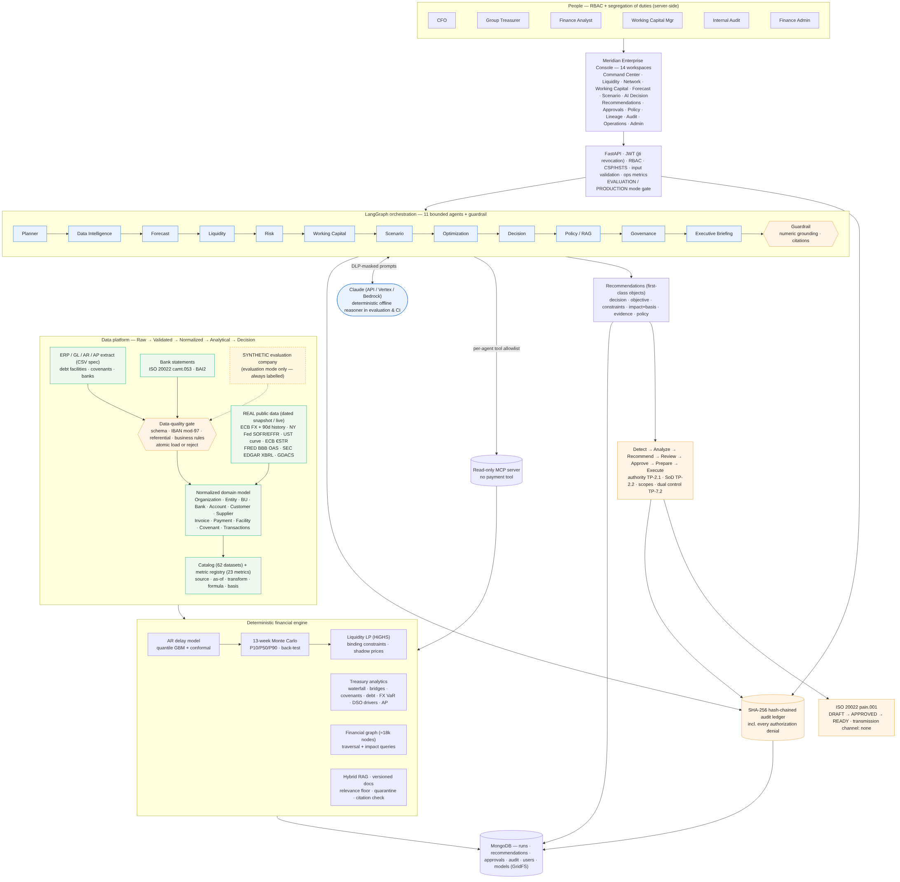

# MERIDIAN v3: platform design and evidence

> **v3.1 update.** The primary case is now **Caterpillar Inc. (PUBLIC · REAL, SEC EDGAR XBRL)**. See
> [`PUBLIC_COMPANY_CASE.md`](PUBLIC_COMPANY_CASE.md) for its data, metrics and rules, and
> [`FINAL_VERIFICATION_REPORT.md`](FINAL_VERIFICATION_REPORT.md) for current results. The synthetic "Orion" company
> described below remains as the separately labelled SYNTHETIC · EVALUATION case, used for transaction-level
> capabilities only. Figures quoted in this document for Orion are evaluation figures, never real.

This document covers the fifteen deliverables of the v3 upgrade. Every figure quoted here comes from the
evaluation dataset (`SYNTHETIC`, seed 7, as of 2026-10-06) or from the dated real public-data snapshot
(2026-10-05/06), unless it says otherwise.

---

## 1. Final architecture



| Layer | Responsibility | Code |
|---|---|---|
| Enterprise console | 14 workspaces. Shell with org selector, command palette (Ctrl+K), environment chip, data-freshness chip, approval and alert notifications, identity, role and secure logout. Validated chart palette and basis badges on every metric | `console/` |
| API | FastAPI. JWT with `jti` revocation. Permission-based RBAC with every denial audited. CSP, HSTS, Permissions-Policy. Pydantic input limits. Request and job metrics | `api/main.py`, `security/auth.py`, `observability/ops.py` |
| Data platform | Raw → Validated → Normalized → Analytical → Decision. 62 catalogued datasets and 14 connectors, with a data-quality gate | `ingest/`, `market/`, `platform/`, `provenance.py` |
| Domain model | Organization, Legal Entity, Business Unit, Bank, Bank Account, Currency, Customer, Supplier, Invoice (AR), Bill (AP), Payment, Bank Transaction, Debt Facility, Covenant, Interest and FX rates, Forecast, Scenario, Risk, Recommendation, ProposedAction, Approval, Policy, Evidence and Audit Event | `domain/models.py`, `decision/`, `governance/` |
| Financial engine | Deterministic and testable: treasury analytics, ML payment-delay model, Monte-Carlo forecast, LP optimiser, scenarios and the metric registry | `analytics/`, `ml/` |
| Graph intelligence | About 17.9k nodes and 28k edges built from application data, with traversal and impact queries | `analytics/graph_intel.py` |
| Agents | 11 bounded agents plus a deterministic guardrail on LangGraph, each with its own MCP tool allowlist | `orchestration/`, `agents/`, `mcp_server/` |
| RAG + policy-as-code | Versioned documents, hybrid retrieval, a relevance floor, quarantine and citation verification; YAML policy | `nlp/rag.py`, `config/treasury_policy.yaml`, `governance/policy.py` |
| Workflow | Recommendation → Submit → Approve/Reject → Prepare (6 checks) → Release (dual control + channel) | `orchestration/service.py` |
| Audit | Append-only SHA-256 hash chain. Unique sequence in MongoDB. Verify endpoint | `governance/audit.py` |
| Persistence | MongoDB (production) or in-memory (evaluation). GridFS model registry | `store/` |

## 2. Data-source inventory

| Source | Dataset id | Classification | Standard / access | As of (snapshot) | Used for |
|---|---|---|---|---|---|
| ECB euro reference rates | `market.fx` | PUBLIC · REAL | eurofxref XML | 2026-10-06 | USD translation of every balance and invoice |
| ECB 90-day FX history | `market.fx_history` | PUBLIC · REAL | eurofxref-hist-90d | 2026-10-06 | FX translation in the cash bridge; realised volatility → 1-month 95% VaR |
| NY Fed SOFR (+ history) | `market.sofr`, `market.sofr_history` | PUBLIC · REAL | NY Fed Markets API | 2026-10-05 (3.89%) | Revolver and term-loan floating rates, rate sensitivity |
| NY Fed EFFR | `market.effr` | PUBLIC · REAL | NY Fed Markets API | 2026-10-05 (3.88%, target 3.75–4.00%) | Rates context |
| U.S. Treasury par yield curve | `market.ust_curve` | PUBLIC · REAL | Treasury CSV | 2026-10-06 (5Y 5.03%) | New-issue cost estimate (refinancing) |
| ECB €STR | `market.estr` | PUBLIC · REAL | ECB Data Portal SDMX | 2026-10-06 (2.439%) | EUR deposit context |
| FRED ICE BofA BBB OAS | `market.credit_spread` | PUBLIC · REAL | FRED CSV `BAMLC0A4CBBB` | 2026-10-05 (1.04%) | New-issue cost estimate |
| SEC EDGAR XBRL company facts | `market.peer_benchmarks` | PUBLIC · REAL | SEC JSON (fair-access UA) | FY2025/26 10-K | Peer DSO/DPO/DIO with filing accession and concept lineage, 4-year history |
| GDACS alerts | `market.hazards` | PUBLIC · REAL | GDACS RSS | 2026-10-07 (42 alerts) | Hazard exposure of entities and customers |
| ERP extract | `company.entities/receivables/payables/counterparties/recurring` | SYNTHETIC (evaluation) / CLIENT_DATA (production) | Meridian package spec v1 (CSV) | 2026-10-06 | Everything company-specific |
| Bank statements | `company.bank_balances`, `company.bank_transactions` | SYNTHETIC / CLIENT_DATA | ISO 20022 camt.053 (BAI2 supported) | 2026-10-06 | Balances, cash bridge |
| Debt facilities, covenants, banks | `company.debt_facilities`, `company.covenants`, `company.banks`, `company.facility` | SYNTHETIC / CLIENT_DATA | CSV spec | 2026-10-06 | Debt profile, covenant tests, counterparty limits |
| ERP API, bank host-to-host, SSO | — | — | SAP/Oracle/NetSuite APIs, SWIFT FileAct, OIDC | **NOT_CONFIGURED** | Interface contracts only. Not claimed |

All three classes are kept apart in the catalog and in every badge. Production mode refuses `SYNTHETIC`. Every
key metric shows Source → Dataset → Date → Transformation → Calculation → Recommendation in **Data Lineage → Metric
lineage explorer** and in each metric's lineage drawer (click any KPI tile).

## 3. Business problem (problem → diagnosis → quantification → recommendation → governance → decision → execution → audit)

| Step | Evaluation-company result | Basis |
|---|---|---|
| **Problem** | Cash is fragmented across 17 entities, 37 accounts and 14 currencies. 66% of it sits at one bank. A $430M term loan matures in 11 months | OBSERVED |
| **Diagnosis** | Cash rose $195.9M → $225.2M over 8 weeks (bank-statement bridge). DSO rose 68.0 → 71.1 days in 90 days, led by Mosaic Marine (+1.01 d), Nimbus and Juniper. Supplier discount capture is 55% | OBSERVED / CALCULATED |
| **Quantification** | Liquidity $605.2M against the $250M covenant. Deployable cash $114.8M after $50.7M trapped cash and $59.8M of buffers. DSO increase ties up $26.6M. Missed discounts $2.29M over 270 days. +100 bps on floating debt costs $6.5M/yr. Refinancing the TLA at an estimated 6.32% costs +$2.92M/yr | CALCULATED / ESTIMATED |
| **Recommendation** | R01 concentrate cash ($2.14M/yr) · R02 repay $49M of the RCF ($1.02M/yr) · R03 capture 29 discounts ($129K) · R04 collections (≤ $26.6M cash release, ESTIMATED, capped at evidence) · R05 refinancing mandate · R06 bank rebalancing ($58.9M over limit) · R07 payment discipline (advisory) | each labelled |
| **Governance** | Approval matrix TP-2.1, SoD TP-2.2, role scopes, management floor TP-3.3, bank limits TP-5.2, refinancing window DP-2.1 | policy-as-code |
| **Decision** | Submitted by the analyst. The Treasurer is blocked (CFO authority). The CFO approves R02. The Treasurer rejects R06 with a rationale | audited |
| **Execution** | pain.001 DRAFT → APPROVED → READY after 6 validation checks. Release refused: dual control and no bank channel | audited |
| **Audit** | Hash chain valid. Every denial, decision and preparation recorded | verifiable |

No ROI is claimed beyond what the evidence supports. The optimiser benefit is a CALCULATED 13-week cost difference
under stated cost assumptions. Collections and refinancing figures are ESTIMATED, and the DSO-peer gap is labelled
as an opportunity, not a forecast.

## 4. Agent architecture

The LangGraph chain runs in this order: `planner → data_intelligence → forecast → liquidity → risk → working_capital →
scenario → optimization → decision → policy → governance → briefing → guardrail`. Two side routes exist: insight
(executive questions) and policy_answer.

| Agent | Responsibility | Controlled tools (MCP, read-only) | Output | Validation |
|---|---|---|---|---|
| Planner | Classify the request and build a typed Scenario | search_treasury_policy | Plan | schema, labelled set (accuracy 1.0) |
| Data Intelligence | Check data fitness, classification, freshness and the DQ gate | get_data_provenance, get_data_quality | AgentFinding | grounding |
| Forecast | 13-week bands, headroom, funding requirement | get_treasury_kpis, run_cash_forecast | AgentFinding | grounding, WAPE gate |
| Liquidity | Positions, bridge, deployable and trapped cash | get_entity_cash_positions, get_liquidity_overview | AgentFinding | waterfall reconciliation |
| Risk | Debt, covenants, rate/FX/counterparty/hazard register | get_risk_events, get_debt_profile, get_risk_register | AgentFinding | grounding, ESTIMATED labels |
| Working Capital | DSO/DPO drivers, collections, discounts | get_collections_priorities, get_early_pay_opportunities, get_working_capital_drivers | AgentFinding | contributions sum to change |
| Scenario | Requested scenario vs stress and hazards on the same paths | compare_scenarios | AgentFinding | monotonic stress tests |
| Optimization | Explain the LP: objective, binding constraints, shadow prices | optimize_liquidity, get_early_pay_opportunities, get_debt_profile | AgentFinding | constraint tests |
| Decision | Build recommendations and actions from verified evidence only | — | Recommendation[] | overclaim cap, schema |
| Policy / RAG | Cite and verify the governing clauses | search_treasury_policy | AgentFinding | relevance floor, citation verification, quarantine |
| Governance | 7 deterministic checks before humans see anything | — | checks | pass/fail |
| Executive Briefing | CFO briefing | — | CFOBriefing | blocking numeric grounding |
| Guardrail | Grounding, DLP, injection, LLM budget (24 calls/run) | — | GroundingResult | unit-tested |

**Failure handling.** `guarded()` wraps every agent. An exception becomes a `FAILED` finding with confidence 0. The
failure is recorded as `agent_failed` in the ledger, and the Decision agent excludes that agent's evidence. The
run continues in degraded mode. This is tested in `test_agent_failure_degrades_run_without_inventing_evidence`.
**Traceability.** Every tool call, finding and output is hash-chained. Runs record their policy hash, model id,
seed, market mode and LLM provider (Reproducibility panel).

## 5. Graph architecture

`FinancialGraph` is built from application data, not from a demo fixture. Node counts: Organization 1, Entity 17,
Country 16, Bank 4, BankAccount 37, Currency 14, BusinessUnit 3, Customer 150, Invoice 5,244, Payment 7,630,
Supplier 80, Bill 4,601, DebtFacility 3, Covenant 3, Dataset 62, Metric 23, Risk 8. Recorded runs add
Recommendations, Actions and PolicyClauses. Edge types include `HAS_ENTITY`, `HOLDS_ACCOUNT`, `AT_BANK`, `DENOMINATED_IN`, `BILLED`, `SETTLED_BY`,
`BORROWED_BY`, `HAS_COVENANT`, `PRICED_OFF`, `DERIVED_FROM`, `COMPUTED_FROM`, `EVIDENCED_BY` and `GOVERNED_BY`.

| Question | Query | Traversal |
|---|---|---|
| Which entities have excess cash? | `q_excess_cash` | Organization → Entity → BankAccount → Currency, compared with buffers and capital controls |
| Where is concentration risk? | `q_concentration` | Bank ← BankAccount ← Entity, share vs TP-5.2 limit |
| What drives overdue AR? | `q_overdue_drivers` | Customer → Invoice (open, overdue) → Entity / BU |
| Which suppliers offer opportunity? | `q_supplier_opportunities` | Supplier → Bill (discount terms vs cost of funds) |
| Where is refinancing risk? | `q_refinancing` | DebtFacility maturity vs the DP-2.1 window |
| Which covenants are near breach? | `q_covenants` | DebtFacility → Covenant → headroom |
| Which recommendations depend on a source? | `q_source_dependencies` | Dataset → (DEPENDS)* → Metric / Recommendation |
| What is the downstream impact? | `q_impact` | Any node → downstream closure (e.g. SOFR → facilities → interest → covenants → recommendations) |

The console draws a BFS-ordered subgraph (organization hubs are not expanded). Node drawers show properties,
relationships and downstream impact.

## 6. RAG and policy architecture

* **Documents.** Treasury policy v2026.2, debt and funding policy, payment policy, repatriation guidelines, RCF
  and term-loan extracts, and supplier contracts. Each document carries
  `<!-- meta: version; effective; owner; classification -->`. Chunks carry `doc_version`, `effective`, `owner` and
  `doc_sha256`. All documents are fictional and marked as such.
* **Retrieval.** Embeddings (hashing, or MiniLM when installed) combined with BM25 through reciprocal-rank fusion.
  Each hit returns `relevance`, `relevant` (floor 0.08), `confidence`, `retrieved_at` and `citation`. Off-topic
  queries are flagged and no clause is cited for them.
* **Defences.** Injection patterns are quarantined at ingestion: the supplier clause SC7-2 is stored for audit and
  never retrieved. Injection-like queries are flagged. `verify_citations()` rejects clause ids the retrieval did not
  return. The numeric-grounding guardrail blocks any dollar figure that is not in tool output. The LLM never sees
  raw IBANs.
* **Policy-as-code** (`config/treasury_policy.yaml`, version 2026.10-t2) defines the approval matrix by action type
  and amount, role hierarchy and scopes, liquidity floors and bank limits, debt policy, revolver prepayment rules,
  execution release roles and channel, tool permissions and the LLM budget.
* **Trace.** Recommendation → evidence refs → tool calls → datasets → policy clauses (document version) → approval
  → audit, rendered as a DAG at `/v1/lineage/recommendations/{rec_id}`.

## 7. Financial-model architecture

| Model | Method | Output basis |
|---|---|---|
| Liquidity waterfall | Cash → − trapped (CR-* allowances) → − buffers (TP-3.1) → deployable cash → + undrawn RCF | OBSERVED → CALCULATED |
| Cash bridge (8 weeks) | Bank-statement entries by category, plus FX translation from the real ECB 90-day history | OBSERVED + CALCULATED |
| Forward bridge / 13-week forecast | Monte Carlo (400 paths) over ML-predicted customer payment dates. Billing, AP and recurring flows. Debt service per facility (floating at SOFR + margin, fixed coupons, amortisation). P10/P50/P90, covenant and management floors, funding requirement | FORECAST |
| Forecast vs actual | Point-in-time rewind (no look-ahead), model re-trained on data available then. WAPE 9.1% vs 69.7% for the ERP due-date convention | CALCULATED |
| AR payment-delay model | Quantile gradient boosting with conformal calibration. MAE 3.42 d vs 5.47 baseline, coverage 0.79 | FORECAST |
| Covenants | Net leverage, interest cover and liquidity, today and on the P10 path, with EBITDA stress | CALCULATED / FORECAST / SCENARIO |
| Debt and rates | Maturity ladder, fixed share vs DP-3.1, +100 bps sensitivity, refinancing cost = UST 5Y + BBB OAS + 25 bps premium | CALCULATED / ESTIMATED |
| FX exposure | Net (cash + AR − AP) by currency. 1-month 95% VaR = 1.645 · σ_90d · √(21/252), undiversified | ESTIMATED |
| Working capital | DSO bridge with exact additive contributions (by customer with a net-remainder row, entity, BU, aging). DPO on open AP vs 90-day purchases. AP behaviour (captured/missed discounts, early without discount, late) | CALCULATED |
| Optimiser | SciPy HiGHS LP on P10 trough balances. Objective: transfer frictions + revolver interest − deposit yield + overdraft penalty. Constraints: buffers, repatriation, no yield arbitrage, RCF-8.1 rounding. Reports binding constraints with **shadow prices** (duals) | CALCULATED |
| Metric registry | 23 metrics, each with `basis`, `formula`, `inputs` (catalog datasets), `steps` and `data_product` | — |

## 8. Security and RBAC

* **Authentication.** PBKDF2-SHA256 (600k iterations), lockout after 5 failures, identical errors for unknown
  users. JWT HS256 with `jti`. Logout revokes the token server-side. Evaluation accounts are refused outside
  evaluation mode.
* **Authorization.** Checked server-side per permission (`run_agents`, `submit_recommendations`, `decide_actions`,
  `prepare_execution`, `release_payments`, `view_bank_details`, `verify_audit`, `view_operations`, `admin`). Every
  denial is audited as `authorization_denied`.

| Role | Run | Submit | Decide | Prepare | Release | Audit | Ops | Admin |
|---|---|---|---|---|---|---|---|---|
| Finance Analyst | ✓ | ✓ | collections only (scope) | | | | | |
| Working Capital Manager | ✓ | ✓ | collections + early-pay (scope) | | | | | |
| Group Treasurer | ✓ | ✓ | up to TP-2.1 limits | ✓ | ✓ (dual control) | ✓ | ✓ | |
| CFO | ✓ | ✓ | all | ✓ | ✓ (dual control) | ✓ | ✓ | |
| Internal Audit | | | | | | ✓ | ✓ | |
| Finance Administrator | | | | | | ✓ | ✓ | ✓ |

* **Hardening.** CSP (`default-src 'self'`, no inline script, `frame-ancestors 'none'`), HSTS on HTTPS,
  `nosniff`, Permissions-Policy. Pydantic length and pattern limits (an invalid query returns 422). Secrets come only
  from the environment. The admin API enforces password length. DLP masks IBANs in prompts.
* **AI restrictions.** No agent has a payment or write tool, and tools are allowlisted per agent. The LLM budget
  is capped per run. Outputs must pass numeric grounding and citation checks.

## 9. Approval and SoD workflow

```
PROPOSED ──submit──► SUBMITTED ──approve (authority + SoD + scope)──► APPROVED ──prepare (6 checks)──► READY ──release──► TRANSMITTED
     └───────────────────────── reject (written rationale) ──────────► REJECTED                          (blocked: channel none)
```

* **Authority.** The approval matrix routes by action type and amount (e.g. intercompany ≤ $10M → Treasurer,
  otherwise CFO, plus capital controls → CFO; revolver → CFO; refinancing → CFO; bank rebalancing → Treasurer).
* **Segregation of duties.** The run requester and the submitter can never approve. Administrators and auditors
  can never decide. The release signatory must differ from the requester, submitter and approver.
* **Preparation checks.** Debtor IBAN check digits, creditor identifier, amount equals the approved amount,
  available funds, no duplicate file, business-day execution date.
* **Release.** Needs `release_payments`, READY state, dual control **and** a configured channel. This deployment
  has `transmission_channel: none`, so release always returns 409 and is audited as `release_blocked`.
* **History.** requested_by, submitted_by, approved_by/rejected_by, prepared_by, and every refusal.

## 10. Audit design

An append-only ledger. Each record holds `seq`, `ts`, `actor`, `action`, `run_id`, `payload`,
`prev_hash` and `hash = SHA-256(prev_hash ‖ canonical JSON)`. MongoDB enforces a unique sequence, so concurrent
replicas cannot fork the chain (tested against a real mongod). It records sign-ins and failures, data loads,
tool calls, agent outputs, agent failures, guardrail results, governance checks, recommendation submissions,
decisions, denials, preparation and blocked releases, and user administration. `GET
/v1/governance/audit/verify` recomputes the chain. Lineage covers recommendation (rec → evidence), model (model id
plus card), data (dataset checksums and as-of), policy (policy hash and document version) and approval (stamps
plus record hashes).

## 11. Production readiness

| Check (production gate) | Evaluation deployment | Production requirement |
|---|---|---|
| Operating mode | DEMO (evaluation) | `MERIDIAN_MODE=production` |
| Persistence | in-memory | MongoDB reachable (+ Atlas vector index) |
| LLM | mock deterministic reasoner | real Claude endpoint, verified with `meridian llm-check` |
| Signing key | dev key | ≥ 32 bytes from the secret manager |
| Company data | SYNTHETIC | CLIENT_DATA loaded via `meridian ingest`, validated |
| Accounts | evaluation accounts | provisioned users (CFO approver required); evaluation accounts refused |
| Market data | dated snapshot | live, SEC user agent set |
| Release identifier | — | `MERIDIAN_GIT_SHA` |

`meridian doctor` prints the gate. Production refuses to start on any FAIL. **System Operations** shows API p50
and p95 latency, 4xx and 5xx counts, DB status, data freshness, audit chain, agent step latency and grounding,
jobs (warm-up, runs), model, RAG, forecast quality and recommendation quality.

## 12. Test results

| Suite | Result |
|---|---|
| Default suite (`pytest -q`) | **166 passed, 4 skipped** (the skips are MongoDB tests that need `MERIDIAN_TEST_MONGODB_URI`) |
| MongoDB production path (real mongod 8.0.15) | **4 passed** |
| Ruff | clean |
| API contract smoke (`scripts/smoke_api_contract.py`, live server) | all OK |

New in v3: `tests/unit/test_v3_enterprise.py` (25 tests: domain, treasury analytics, metric lineage, catalog,
data-class separation, connectors, graph queries, RAG metadata/relevance/quarantine/citations, optimiser duals,
recommendation status, BAI2 and camt.053 round trips) and `tests/integration/test_v3_workflow_and_api.py` (36 tests:
enterprise endpoints, graph queries, lineage, full lifecycle, SoD, scopes, rejection, denial audit, logout
revocation, CSP, input validation, admin user lifecycle, admin cannot approve, ops, degraded agent failure).

The 98-test v2 baseline still passes. Two v2 assertions were changed on purpose, and both are disclosed:
(1) `test_no_endpoint_executes_payments` now asserts that the only execution path is the dual-control
`/release` endpoint and that `transmission_channel == "none"`; (2) the console test now checks the v3 modules
instead of the removed `pages.js`.

## 13. Evaluation results (11 release gates, three seeds)

| Gate | Seed 7 | Seed 11 | Seed 23 | Target |
|---|---|---|---|---|
| AR model MAE (days) vs customer-average baseline | 3.42 vs 5.47 | 3.86 vs 6.52 | 3.49 vs 5.97 | below baseline |
| Collections WAPE | 9.1% | 12.4% | 8.8% | ≤ 15% |
| vs ERP due-date assumption | 69.7% | 67.3% | 61.3% | 3× better |
| P10–P90 coverage | 0.792 | 0.761 | 0.780 | 0.72–0.90 |
| Optimiser residual shortfalls | 0 | 0 | 0 | 0 |
| Trapped cash respects allowances | ✓ | ✓ | ✓ | ✓ |
| Briefings grounded | 3/3 | 3/3 | 3/3 | all |
| Planner accuracy | 1.0 | 1.0 | 1.0 | ≥ 0.9 |
| RAG hit@3 | 1.0 | 1.0 | 1.0 | ≥ 0.8 |
| Injected chunk quarantined | 1 | 1 | 1 | 1 |
| Audit chain valid | ✓ | ✓ | ✓ | ✓ |
| **Gates passed** | **11/11** | **11/11** | **11/11** | |

The optimiser recommended revolver repayments of $49M, $39M and $28M, with annualised benefits of $3.16M, $3.23M
and $3.84M (CALCULATED). Full outputs are in `docs/evaluation-results-seed{7,11,23}.md`.

## 14. Screenshots

All 14 workspaces are in `docs/images/v3/` (rendered by headless Chromium against the running API, with no
console errors):
`01_command` · `02_liquidity` · `03_network` · `04_working-capital` · `05_forecast` · `06_scenarios` ·
`07_copilot` · `08_recommendations` · `09_approvals` · `10_policy` · `11_lineage` · `12_audit` · `13_operations` ·
`14_admin`.

The acceptance journey is in `docs/images/v3/journey/`:

| # | Step | Who |
|---|---|---|
| 01–03 | Sign in → Executive Command Center → run analysis → risks and recommendations | Analyst |
| 04–05 | Drill into DSO drivers → metric lineage drawer (source → date → transform → formula) | Analyst |
| 06 | Ask the copilot "What is causing the DSO increase?" (conclusion, impact, sources, policy, confidence) | Analyst |
| 07 | Scenario Lab: collections +20%, rates +100 bps, EUR −5%, EBITDA −15%, covenants re-tested | Analyst |
| 08–11 | Recommendation R02: impact → evidence → data-lineage DAG → policy | Analyst |
| 12 | Submit R02 for approval (IN_REVIEW) | Analyst |
| 13 | SoD: the requester cannot approve her own run's collections action | Analyst |
| 14 | Authority: the Treasurer cannot approve a CFO-level revolver repayment | Treasurer |
| 15–16 | CFO reviews the evidence chain and approves; pain.001 DRAFT is generated | CFO |
| 17 | Treasurer rejects R06 with a written rationale | Treasurer |
| 18–19 | Prepare execution: 6 checks → READY (not transmitted) | Treasurer |
| 20 | Release refused (no bank channel, dual control), audited | Treasurer |
| 21–22 | Audit: denials filter, ledger with valid hash chain | Treasurer |
| 23–24 | Recommendation approval trail and lineage after the decision | Treasurer |
| 25 | Data Lineage workspace | Treasurer |

## 15. Known limitations

* **Synthetic company.** The evaluation company is synthetic. Back-test results show that the method and the
  controls work. They do not predict results on client data, where the model must be re-trained and re-validated.
* **No live LLM verified.** No live Claude call was made in this build. Agents ran on the deterministic offline
  reasoner, and the console says so. Configure credentials and run `meridian llm-check` before relying on
  LLM-written text.
* **Vector search not tested on Atlas.** MongoDB persistence was tested against a local mongod. Atlas
  `$vectorSearch` was not executed; evaluation uses in-process cosine + BM25.
* **No ERP, bank or SSO connectivity.** ERP APIs, bank host-to-host/SWIFT and OIDC SSO are interface contracts,
  `NOT_CONFIGURED`. BAI2 parsing is implemented and tested, but the evaluation load uses camt.053.
* **Transmission disabled.** Payment transmission is disabled by design (`transmission_channel: none`). READY is
  the furthest state Meridian reaches.
* **Narrow forecast band.** The P10–P90 band models customer payment-timing uncertainty only. Macro shocks are
  handled as scenarios, not inside the band, so the band is narrow relative to total liquidity.
* **Simplified financials.** Covenant EBITDA is a single LTM input (OBSERVED from the facility certificate in
  evaluation). Refinancing cost and FX VaR are ESTIMATED with stated assumptions (undiversified VaR).
* **Fictional documents.** Policy and agreement documents are fictional extracts and must be replaced with the
  client's executed versions.
* **Market data snapshot.** Market data in evaluation is a dated snapshot. Live mode needs network egress to the
  official sources. SEC peer data was missing concepts for one filer (Cummins), which is therefore excluded.
* **Test-harness CSP noise.** The screenshot harness's `wait_for_function` triggers a CSP `unsafe-eval`
  refusal in Chromium. This comes from the harness (it evaluates a string), not from the application, which runs
  under a strict CSP with no eval.
