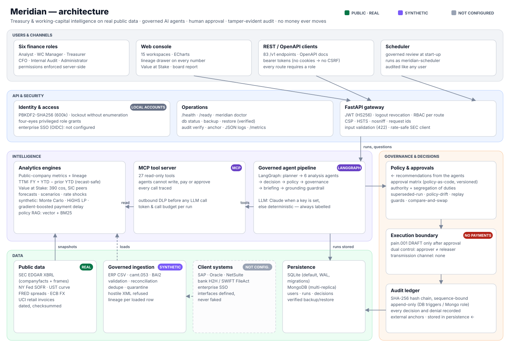
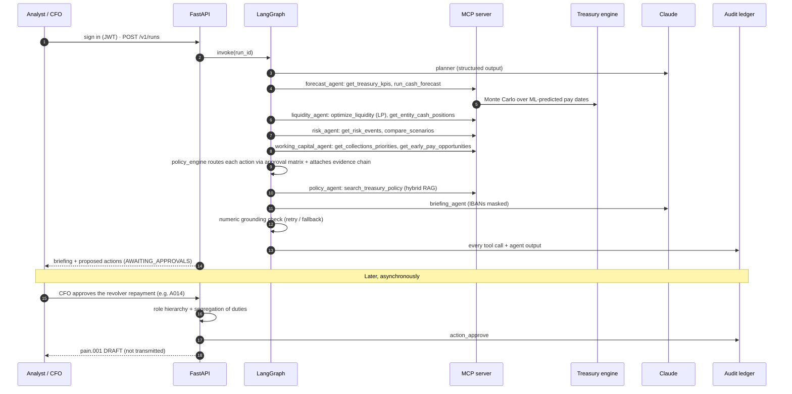

# Architecture

> **v3:** the full v3 design (data platform layers, 11-agent chain, graph intelligence, recommendation lifecycle, dual-control release, observability) is in [`PLATFORM_V3.md`](PLATFORM_V3.md). This page keeps the core engine description.

## Layers

| Layer | Responsibility | Key modules |
|---|---|---|
| Experience | Treasury Console (sign-in, RBAC-aware views), REST API | `console/`, `api/main.py`, `security/auth.py` |
| Data | Governed ingestion (ERP CSV + camt.053), public market connectors, provenance register | `ingest/`, `market/`, `provenance.py` |
| Agents | Plan, analyse, recommend, explain | `orchestration/graph.py`, `agents/*` |
| Tool protocol | Governed, read-only tool surface (MCP) | `mcp_server/server.py`, `orchestration/gateway.py` |
| Treasury engine | All numbers: ML, forecast, optimisation, scenarios, RAG | `analytics/*`, `ml/ar_model.py`, `nlp/*` |
| Governance | Policy-as-code, approvals, DLP, grounding, audit | `governance/*`, `config/treasury_policy.yaml` |
| Persistence | SQLite by default (WAL, migrations, append-only audit); MongoDB for multi-replica; in-memory only in tests | `store/*` |
| Execution | ISO 20022 pain.001 drafts after approval | `execution/payments.py` |

## A daily run, step by step

## Design decisions

See `docs/adr/`. In short:

1. **LangGraph for control flow** keeps the order of steps explicit and auditable. Agents run as a sequential,
   governed chain (Planner → Forecast → Liquidity → Risk → Working capital → Policy → Briefing → Guardrail), so each one
   sees the validated output of the one before it.
2. **Math is done by solvers and models, not by the LLM.** The LP finds where cash should sit, the model
   predicts pay dates, and the LLM explains the results.
3. **MCP as the only data path for agents**, and it has no payment tool.
4. **Approvals live outside the graph** as durable state in MongoDB. They are asynchronous and multi-party,
   and can take days.
5. **MongoDB Atlas holds both the operational documents and the vector index**, so there is no second database to secure.
6. **No containers required.** Deploys on managed Python runtimes (Render, Cloud Run source deploy, App Runner) or
   systemd on a VM. Claude is reachable directly or inside the client's cloud through Vertex AI or Bedrock.
